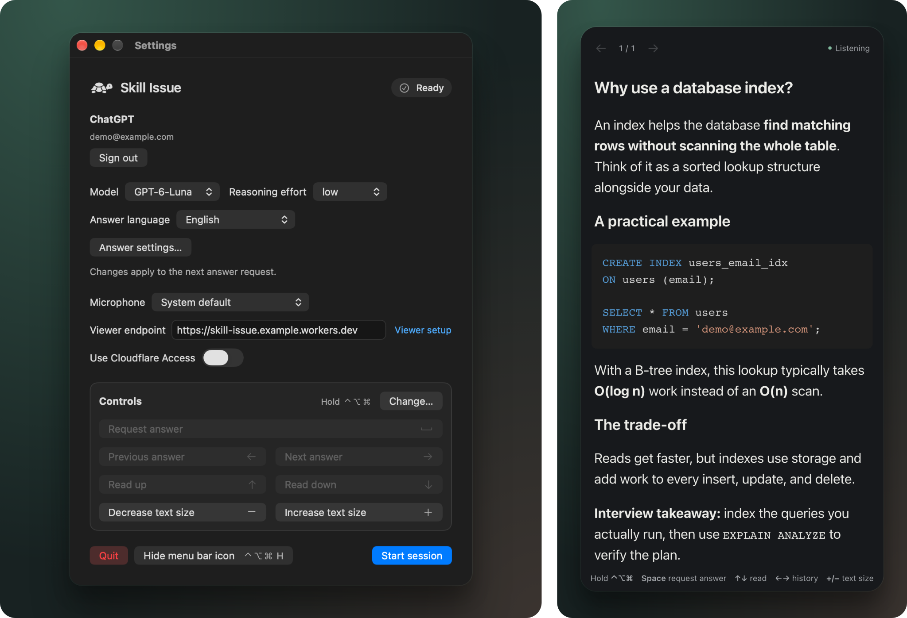

# Skill Issue 🐢

[](https://github.com/hu553in/skill-issue/actions/workflows/ci.yml)

A macOS menu bar interview assistant that transcribes computer audio and your microphone locally.
Request answers through your ChatGPT subscription, using the conversation and a screenshot of your
main display as context. Read answers on your phone and control the encrypted viewer from your Mac.

Skill Issue is opinionated and simple, with few controls and predictable defaults to keep it **easy
to use under interview stress**.

<p align="center">
  <a href="assets/screenshots/overview.svg"></a>
</p>

<p align="center"><em>macOS settings and the phone viewer. Demo account and sample answer.</em></p>

- [Install](#install)
- [Viewer setup](#viewer-endpoint)
- [Usage](#usage)
- [Update and uninstall](#update-and-uninstall)
- [Cloudflare Access](#cloudflare-access)
- [Recovery](#recovery)
- [Data and privacy](#data-and-privacy)
- [Development](#development)
- [License](#license)

## Install

You need:

- A Mac with Apple Silicon and macOS 26 or later.
- A ChatGPT account with access to
  [Sign in with ChatGPT](https://developers.openai.com/siwc/token-sharing-open-source).
- A Cloudflare account to host the viewer for your phone.

Choose Homebrew or the ZIP below. To build the app from source, see [Development](#development).

### Homebrew

Install with [Homebrew](https://brew.sh). If switching from a manual installation, quit the app and
remove its old copy from Applications first:

```sh
brew install --cask hu553in/tap/skill-issue
```

### Download the app

1. Download `Skill-Issue-macos-arm64.zip` from a
   [release](https://github.com/hu553in/skill-issue/releases).
2. Extract the ZIP and move `Skill Issue.app` to Applications.

### Open the app

Open Skill Issue to show Settings. Afterward, click its menu bar icon to open or close Settings.

The app is ad hoc signed without an Apple developer certificate and is not notarized. If macOS
blocks it, use **System Settings > Privacy & Security > Open Anyway** after attempting to open it;
see [Apple's instructions](https://support.apple.com/en-us/102445).

<details>
<summary>Remove the download quarantine in Terminal</summary>

Run the command below, then open the app again:

```sh
xattr -dr com.apple.quarantine "/Applications/Skill Issue.app"
```

The command removes only the download quarantine attribute and preserves other extended attributes.

</details>

Continue with [Viewer setup](#viewer-endpoint) before starting a session.

## Viewer endpoint

The viewer is the page you open on your phone. The relay passes encrypted answers from the Mac to
that page. Both run in one Cloudflare Worker in your account, where Cloudflare's limits and billing
apply. The Worker needs no ChatGPT credentials or open ports on your Mac.

**Use matching versions of the app, viewer and relay.** In Settings, select **Viewer setup** next to
**Viewer endpoint**:

| App label        | Where Viewer setup takes you                                                         |
| ---------------- | ------------------------------------------------------------------------------------ |
| A version number | The setup instructions for that release                                              |
| **local build**  | [Deploy from a checkout](#deploy-from-a-checkout), using the same source as your app |

### First deployment

1. Open **Viewer setup** in the app. For a released app, follow **First deployment** on the release
   page and use its **Deploy to Cloudflare** button. For a **local build**, follow
   [Deploy from a checkout](#deploy-from-a-checkout).
2. Complete the deployment instructions, including the build settings and Git disconnection step for
   the Cloudflare button. Copy the Worker's production URL into **Viewer endpoint**.
3. Optionally [configure Cloudflare Access](#cloudflare-access), then [start a session](#usage).

Cloudflare Access restricts the deployment to your Mac and approved browser users. Without Access,
anyone can create rooms and use your deployment's resources, subject to IP rate limits. Session
contents remain encrypted.

### Update an existing Worker

**Keep the session stopped until both the app and Worker are updated.** The release's Deploy to
Cloudflare button creates a new project, so use the source instructions to update an existing
Worker.

1. Open **Viewer setup** in the updated app's Settings. If you have not updated the app yet,
   [update the released app](#update-and-uninstall) or rebuild your local app first.
2. Follow **Deploy from source or update an existing Worker** on the release page. For a **local
   build**, follow [Deploy from a checkout](#deploy-from-a-checkout).
3. Keep the same Cloudflare account, Worker name and deployment settings described below. After
   deploying, check that **Viewer endpoint** still uses the same address and
   [start a new session](#usage).

#### Keep your Worker settings

Before deploying from a new checkout:

- Set `name` in `wrangler.jsonc` to your existing Worker name.
- Copy any settings you still need from the existing Worker and previous configuration, including
  variables, custom domains, routes and `workers_dev: false` for a custom-domain-only setup.
- Keep the new checkout's bindings and migrations. If you use Access, repeat the
  [Worker address checks](#4-check-the-workers-other-addresses) after deployment.
- Open the Worker in Cloudflare and select **Settings > Builds > Disconnect** if Git builds are
  still connected. Later pushes to the copied repository must not overwrite your manual deployment.

### Deploy from a checkout

For a **local build**, use the same checkout that you used to build the app. For a released app, use
**Deploy from source or update an existing Worker** on the release page linked by **Viewer setup**;
its commands download the matching tag.

1. Install the latest [Node.js LTS](https://nodejs.org/en/download) and
   [Bun](https://bun.sh/docs/installation) at the version after `bun@` in the checkout's
   `package.json`. From that directory, install dependencies and sign in to Cloudflare:

   ```sh
   bun ci
   bunx wrangler login
   ```

2. Choose the Worker `name` in `wrangler.jsonc`. For an update, sign in to the same Cloudflare
   account and [keep your Worker settings](#keep-your-worker-settings).
3. Deploy the viewer and relay:

   ```sh
   bun deploy
   ```

4. Copy the production URL into **Viewer endpoint**. For an update, confirm that the address has
   stayed the same. Optionally [configure Cloudflare Access](#cloudflare-access), then
   [start a session](#usage).

## Usage

First [set up the viewer endpoint](#viewer-endpoint). Use the Worker's production HTTPS URL when
reading on a phone. The default `http://127.0.0.1:8787` works only on the Mac and is for
[local development](#run-locally).

1. Open Settings and select **Sign in with ChatGPT**. For a saved account, follow
   [ChatGPT accounts](#chatgpt-accounts).
2. Choose your microphone and answer language.
3. Select **Start session** and allow microphone and screen/system audio access. On first use, the
   app downloads about 642 MB of speech-model files.
4. Open the session link on your phone or scan its QR code. Keep the browser in the foreground and
   the phone unlocked.
5. Select **Request answer** in Settings, or hold **Control + Option + Command** and press
   **Space**. Use the [keyboard shortcuts](#keyboard-shortcuts) to read the answer from your Mac.

### Keyboard shortcuts

Hold **Control + Option + Command** for all commands. To use other modifier keys, stop the session
and choose **Change…** next to **Controls**. Pick at least two keys; the choice survives app
restarts and updates every shortcut hint, including the viewer.

| Key   | Action                                                       |
| ----- | ------------------------------------------------------------ |
| Space | Request an answer to the current question                    |
| ↑ / ↓ | Scroll by half the viewer's visible height                   |
| ← / → | Previous / next answer, restoring its reading position       |
| + / − | Increase / decrease text size, keeping your reading position |
| H     | Hide / show the app's menu bar icon                          |

The viewer shows one answer at a time. Use its **← / →** buttons or the Mac shortcuts to switch
answers. While connected, both share the same selection; the last change processed by the Mac wins.
Each answer keeps its reading position, and streaming does not scroll it down automatically.
**Thinking** refers to the current request, including when you read an earlier answer.

If the connection drops, you can keep browsing answers already received in the open viewer. When the
connection returns, the viewer follows the Mac's current selection; offline taps are not replayed.

- **Request again:** Space cancels the current generation and captures fresh context. Its partial
  answer stays in history. Holding Space does not repeat requests.
- **Text size:** starts at 20, changes by 2 from 16 to 40, and survives app restarts. The +/= key
  also accepts an extra Shift when Shift is not part of your chosen modifiers.
- **Hide the icon:** H hides the app's icon; macOS capture indicators remain visible. Reopen the app
  to show Settings when the icon is hidden.

### Settings

- **Model and Reasoning effort** load after ChatGPT sign-in. You can change them between requests.
  Both stay disabled while choices load or an answer is being prepared or generated.
- **Microphone, Answer language, Viewer endpoint and Cloudflare Access** are locked during sessions
  and operations.
- **Answer language** defaults to English and is independent of speech recognition.

<details>
<summary>Model defaults and saved choices</summary>

- The default model is `gpt-6-luna`, or the first available model.
- Reasoning effort defaults to `low`, or the first supported level. If none are available, the
  selector stays disabled.
- Model and effort choices survive app restarts. Changing the model resets effort to its default.

</details>

### ChatGPT accounts

When signed out, choose **Sign in with ChatGPT** if no accounts are saved. Otherwise, select an
**Account** or **Another account**, then choose **Sign in**. Selecting an account does not start
sign-in.

To switch accounts, **Sign out** first. Local tokens are removed and account registrations stay
saved for repeat sign-in. If OpenAI cannot confirm remote sign-out, use
[account recovery](#account-and-keychain-problems) to disconnect it.

### End a session

Select **Stop session** to stop capture and request deletion of the session from the relay. An
already open viewer can still browse received answers with its **← / →** buttons and scroll
normally. Reloading or reopening the link cannot restore a deleted session.

**Starting a new session clears the previous answers and captured context. Quitting the app discards
its history.** The **Quit** button and Command + Q ask for confirmation; **Cancel** keeps the
session running.

## Update and uninstall

Stop the session and quit the app before updating or uninstalling.

To update a Homebrew installation:

```sh
brew update
brew upgrade --cask hu553in/tap/skill-issue
```

For a ZIP installation, replace the app in Applications with the copy from the new release.

Then [update your existing Worker](#update-an-existing-worker) to the installed app's version before
starting a new session.

To uninstall a Homebrew installation:

```sh
brew uninstall --cask hu553in/tap/skill-issue
```

For a ZIP installation, move `Skill Issue.app` from Applications to Trash. Removing the app does not
delete your Cloudflare Worker or its Access configuration.

## Cloudflare Access

Cloudflare Access is optional. After [deploying the Worker](#viewer-endpoint), follow the steps
below to restrict access to your Mac and approved browser users. Create **one Access application
with two separate policies**, with email sign-in for the browser and a service token for the Mac.

### 1. Enable email sign-in

Open **Zero Trust** in your Cloudflare account and complete its initial setup if needed.

Open
[Identity providers](https://dash.cloudflare.com/?to=%2F%3Aaccount%2Fone%2Fintegrations%2Fidentity-providers).
If **One-time PIN** is missing, select **Add an identity provider > One-time PIN** and save to
enable login codes by email.

### 2. Create the Mac's service token

Open
[Service tokens](https://dash.cloudflare.com/?to=%2F%3Aaccount%2Fone%2Faccess-controls%2Fservice-credentials%2Fservice-tokens).

1. Select **Create Service Token**.
2. Set **Service token name** to `Skill Issue Mac`; leave the default duration.
3. Select **Generate token** and copy **Client ID** and **Client Secret** for **Configure…** in
   Skill Issue Settings.

**Copy both values now. The secret is shown only once.**

### 3. Protect the viewer hostname

Open
[Access applications](https://dash.cloudflare.com/?to=%2F%3Aaccount%2Fone%2Faccess-controls%2Fapps).

1. Select **Create new application > Self-hosted and private > Public DNS > Continue with
   Self-hosted and private**. To update an existing application, open its name instead.
2. In **Destinations > Public hostnames**, select **Switch to custom input** and enter the complete
   hostname, for example `skill-issue.example.workers.dev`. **Omit `https://` and any path.**
3. Under **Details**, set **Name** to `Skill Issue`. A custom domain is optional.

**Use Public hostnames, not Add Workers or Worker Access.**

In **Access policies**, use **Create new policy** twice:

| Policy Name           | Action           | Include rule                                 |
| --------------------- | ---------------- | -------------------------------------------- |
| `Skill Issue browser` | **Allow**        | **Emails** > each email you allow to sign in |
| `Skill Issue Mac`     | **Service Auth** | **Service Token** > `Skill Issue Mac`        |

Select **Save policy** after each policy. Leave the optional policy settings at their defaults,
including the MFA override, which stays off. For existing policies, use **Add existing policy**.

**Both policies must appear in the application's Access policies list.**

Under **Authentication > Identity**, turn **Accept all available identity providers** off and choose
**One-time PIN**. Finish with **Create**, or **Save** for an existing application.

### 4. Check the Worker's other addresses

Open [Workers & Pages](https://dash.cloudflare.com/?to=%2F%3Aaccount%2Fworkers-and-pages), then your
Worker.

- **Domains > Worker URL > Production:** keep it on if this protected `workers.dev` address is your
  viewer endpoint.
- **Domains > Worker URL > Preview:** keep it off. The project's `preview_urls: false` keeps preview
  URLs disabled on later deploys.
- **Settings > Builds > Previews Base > Builds for Preview branches:** keep it off if Git builds are
  still connected. Disabling preview builds leaves production-branch deploys enabled.

<details>
<summary>If you use a custom domain or additional routes</summary>

Access protection applies to the hostname you entered, not every address of the same Worker. Check
**Custom Domains and Routes** in the Worker's **Domains** tab. Add each additional hostname under
**Destinations > Public hostnames** in the same Access application, or remove the unused route.

If you use only a custom domain, turn **Worker URL > Production** off to disable `workers.dev`. Also
add `"workers_dev": false` to your checkout's `wrangler.jsonc`; otherwise a later deploy can enable
it again. Keep **Preview** off separately.

</details>

### 5. Connect the Mac and phone

1. In Skill Issue Settings, set **Viewer endpoint** to the protected HTTPS address. Turn **Use
   Cloudflare Access** on, open **Configure…**, paste the token's **Client ID** and **Client
   secret**, then **Save**.
2. On your phone, open the endpoint without a session link and sign in with an allowed email.
3. Follow [Usage](#usage) to start a session and open its full link or QR code on the phone.

If Cloudflare sign-in returns you to a page asking for the private viewer link, reopen that same
link or scan the QR code again. Cloudflare can drop the private part of the link during the first
login.

### Access recovery

| What you see              | What to do                                                                                         |
| ------------------------- | -------------------------------------------------------------------------------------------------- |
| **Setup required** on Mac | Open **Configure…** and save the service token before starting a session.                          |
| Access denied on Mac      | Check the token's expiry and Service Auth policy, update **Configure…**, then start a new session. |
| **Sign in** in the viewer | Sign in again; reopen the session link if needed. The Mac's session continues.                     |
| Temporary connection loss | Wait for automatic reconnection.                                                                   |

- An Access refusal on the Mac [ends the session](#end-a-session). An already open connection checks
  Access again only when it reconnects.
- If you lose the Client Secret,
  [rotate it in Cloudflare](https://developers.cloudflare.com/cloudflare-one/access-controls/service-credentials/service-tokens/#rotate-service-token-secrets)
  and update **Configure…**.
- Turning **Use Cloudflare Access** off keeps the credentials but stops sending them. It does not
  remove the protection in Cloudflare. The app never falls back to unprotected requests
  automatically.
- Access settings are locked during sessions and operations. For local development, leave Access
  off; HTTP is accepted only for loopback addresses.

## Recovery

Answer requests never retry automatically. Recoverable answer errors keep the current session,
answers and captured context. If an error ends the session, the
[session cleanup rules](#end-a-session) apply.

| Problem                          | What to do                                                                                             |
| -------------------------------- | ------------------------------------------------------------------------------------------------------ |
| Temporary answer failure         | Choose **Retry** or **Request answer**, as offered.                                                    |
| ChatGPT usage limit              | Open **View usage** and check when your limits allow another request. Then select **Request answer**.  |
| Usage limit while loading models | Open **View usage** and check your limits. Select **Retry** to reload models when access is available. |
| Viewer connection stopped        | Reload the viewer or reopen the current link from the Mac.                                             |

Temporary viewer interruptions reconnect automatically. For Cloudflare sign-in or service-token
errors, see [Access recovery](#access-recovery).

### Account and Keychain problems

- **Plan permission missing:** choose **Enable ChatGPT plan usage**. If ChatGPT requires sign-in or
  renewed permission during a session, the session stops and shows the recovery action.
- **Saved accounts unavailable:** choose **Retry** before signing in. Saved registrations stay
  intact.
- **Credentials could not be saved:** restore Keychain access, then choose **Retry**. It saves the
  credentials without requesting another answer. Your session and answers stay available; quitting
  before the save succeeds may require signing in again.
- **Remote sign-out unconfirmed:** choose **Open ChatGPT**, then **Settings > Security and login >
  Sign in with ChatGPT > Skill Issue > Disconnect**.

## Data and privacy

### On your Mac

- Audio is transcribed locally by Nemotron and is not uploaded. Computer audio and microphone are
  separate sources, not verified speaker identities. English and Russian were checked; other
  languages have not been evaluated here.
- History stays in memory, including after request errors. Recordings and screenshots are not saved
  to disk. History is not truncated automatically, so long sessions can fill the model's context
  window.
- Model files are cached in `~/Library/Application Support/Skill Issue/Models/`.
- ChatGPT tokens, verified account registrations and Access service credentials stay in Keychain.

### Sent to OpenAI

The app sends chronological transcripts, screenshots and earlier AI suggestions directly to OpenAI.
Each answer request adds a screenshot and the latest transcripts. Reading an old answer does not
change that context.

Requests use your ChatGPT subscription with `store: false`. Model availability and limits depend on
[Sign in with ChatGPT](https://developers.openai.com/siwc/token-sharing-open-source).

### Stored by the viewer and relay

- The relay stores encrypted answers and viewer state using AES-256-GCM. The decryption key is in
  the link's URL fragment, after `#`, and is never sent to the relay. Readers cannot publish state
  or control the Mac.
- **Anyone with the full link can read the session**, unless Cloudflare Access restricts browser
  access. The link remains in browser history.
- The browser saves reading positions, not answer text. During Access sign-in, the tab temporarily
  saves the private viewer link to restore it after login.
- Stop, Quit and fatal session errors stop capture and request room deletion. If deletion cannot
  finish, an abandoned room expires after two hours without activity from the Mac. Active sessions
  renew the expiry time.

Access credentials are sent only to their configured origin, using HTTPS or loopback HTTP, with
redirects blocked. They are not included in session links or QR codes. The viewer has no analytics
or third-party page assets.

## Development

### Setup

Install the development tools:

- Full Xcode with a Swift toolchain satisfying [Package.swift](Package.swift).
- The latest [Node.js LTS](https://nodejs.org/en/download) for the build and deployment tools.
- [Bun](https://bun.sh/docs/installation) at the version after `bun@` in
  [package.json](package.json).
- [Homebrew](https://brew.sh) for SwiftLint and shfmt.

Clone the repository, then run the remaining development commands from its root:

```sh
git clone https://github.com/hu553in/skill-issue.git && cd skill-issue
```

Download the Metal toolchain and install dependencies:

```sh
xcodebuild -downloadComponent metalToolchain
bun ci
bun setup:swift
```

### Run locally

Start the local viewer server:

```sh
bun dev
```

In another terminal, build and launch the app:

```sh
bun run:swift
```

Use `http://127.0.0.1:8787` as **Viewer endpoint** and leave **Use Cloudflare Access** off. Follow
[Usage](#usage) to sign in and start a session, then select **Open viewer** to read on the same Mac.
To use your phone, [deploy the checkout](#deploy-from-a-checkout) and use its HTTPS address instead.

If the app is already running, confirm **Quit** when prompted. The command waits for cleanup before
replacing and relaunching the debug app.

For VS Code debugging, select **Attach to Skill Issue** and choose the running `SkillIssue` process.

### Build and package

```sh
bun build:release
```

The command creates:

- App: `dist/release/Skill Issue.app`.
- ZIP: `dist/Skill-Issue-macos-arm64.zip`.

For a debug bundle, run `bun build:swift`; the output is `dist/debug/Skill Issue.app`. Both commands
include dependency license notices and do not launch the app. Locally packaged apps show **local
build**, including Release builds. CI marks the app as a versioned release when packaging a release
tag.

### README screenshots

From an unlocked macOS desktop, regenerate the Settings and phone viewer collage:

```sh
bun playwright:install
bun screenshots
```

This rebuilds the current UI with a demo account and [sample answer](scripts/screenshots-answer.md),
then updates [overview.svg](assets/screenshots/overview.svg). It briefly opens a separate Settings
window and runs a temporary local viewer. Keep that window in front while it is captured. It does
not sign in, access your Keychain, start capture, or stop your running app. The first run builds a
separate Swift cache in `.build/screenshots`.

The generator preserves the original framing and replaces the SVG only after both captures succeed.
Repeated runs in an unchanged environment leave the SVG untouched. Native controls and font
rendering can change with macOS, Chromium or desktop appearance settings.

### Releases

Run from a clean `main` checkout tracking `origin/main`, with Node.js satisfying
[Release It!'s requirements](https://github.com/release-it/release-it/blob/main/package.json).

For a patch release:

```sh
bun release:patch
```

Use `bun release:minor` or `bun release:major` instead for a larger version change. Release It! runs
the full check, updates `package.json`, creates the release commit and annotated `vX.Y.Z` tag, and
pushes both.

After the web, Swift and sanitizer checks pass, CI publishes the ZIP and generated release notes.
The notes include a Deploy to Cloudflare button pinned to the tag, the Bun version and source
deployment commands.

The app's version and build number come from `package.json`. Packaging rejects a mismatched release
tag. Published tags and assets are immutable, so fixes need a new version.

After publication, CI uses `brew bump` to open a cask update PR in
[`hu553in/homebrew-tap`](https://github.com/hu553in/homebrew-tap). Review and merge it to make the
release available through Homebrew. The tap also checks for updates daily.

<details>
<summary>Homebrew automation setup for maintainers</summary>

Set the `HOMEBREW_TAP_TOKEN` Actions secret in this repository to a fine-grained personal access
token restricted to `hu553in/homebrew-tap`, with **Contents: Read and write** and **Pull requests:
Read and write**.

</details>

### Checks

Swift uses `swift format`, SwiftLint and compiler warnings as errors. Web code uses
Ultracite/Oxlint/Oxfmt, type-aware linting, TypeScript, Stylelint and Knip. Oxfmt also formats
Markdown and configuration files. Shell scripts use shfmt and ShellCheck.

| Command             | Purpose                                                                                    |
| ------------------- | ------------------------------------------------------------------------------------------ |
| `bun lint`          | Check formatting and lint without tests                                                    |
| `bun lint:fix`      | Format and apply lint fixes without tests                                                  |
| `bun check`         | Run the web and Swift checks                                                               |
| `bun check:fix`     | Format, apply lint fixes and run `check`                                                   |
| `bun check:web`     | Web/relay lint, types, config checks, dependency audit, coverage and Chromium tests        |
| `bun check:swift`   | Swift lint, coverage, unused-code analysis, Release packaging and native relay integration |
| `bun test:sanitize` | Run Swift tests with Thread Sanitizer                                                      |

The pre-commit hook runs `check:fix`, which can change files. Commit messages use Conventional
Commits. [CI](https://github.com/hu553in/skill-issue/actions/workflows/ci.yml) runs the web, Swift
and sanitizer checks. Coverage reports go into `coverage/`.

Integration tests use a disposable local Worker without ChatGPT credentials or capture permissions.
Native integration tests check CryptoKit/WebCrypto interoperability through the relay. Real capture,
a live ChatGPT account and physical-phone Safari are not covered by automated tests.

### Speech-model validation

For the optional real-model test, prepare WAV clips of at most 12 seconds:

- `en_constraints.wav`: include "do not sort" and "not the values".
- `ru_constraints.wav`: include "сортировать нельзя" and "а не сами значения".

Clips are resampled to 16 kHz. Run:

```sh
SKILL_ISSUE_ASR_CHECK_DIR=/path/to/fixtures bun test:asr
```

The speech library and model are pinned; updates require real-model validation. Model updates must
also update manifest sizes and hashes and [THIRD_PARTY.md](THIRD_PARTY.md). Renovate updates Bun
dependencies, versioned Swift packages and GitHub Actions.

### Troubleshooting

To inspect app output, run:

```sh
bun run:swift --logs
```

The launch modes below rebuild the debug app and ask you to quit a running copy before launching:

| Command                     | Purpose                                              |
| --------------------------- | ---------------------------------------------------- |
| `bun run:swift --logs`      | Follow stdout/stderr in `dist/app.log`               |
| `bun run:swift --telemetry` | Follow unified system logs for the app               |
| `bun run:swift --debug`     | Start the app under LLDB                             |
| `bun run:swift --verify`    | Launch the app and check that its process is running |

Rebuilding an ad hoc signed app can require Keychain and screen approval again. If screen access
remains denied, remove its old entry in **System Settings > Privacy & Security > Screen & System
Audio Recording**, add the current app bundle, then quit and reopen.

## License

[MIT](LICENSE). See [THIRD_PARTY.md](THIRD_PARTY.md) for dependency and model licenses.
